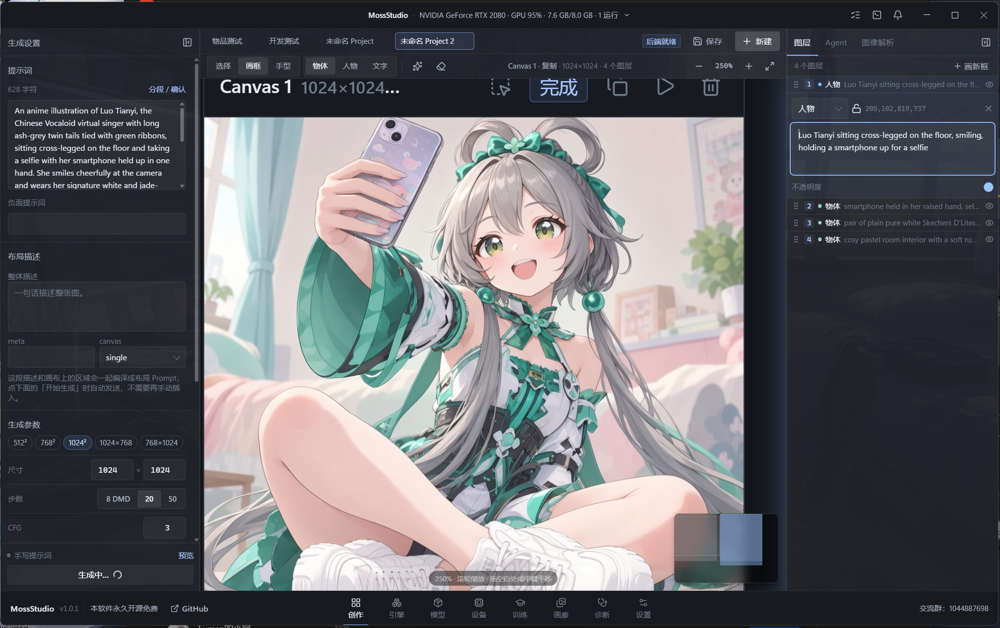

<p align="center">
  
</p>

<h1 align="center">MossStudio</h1>

<p align="center">
  开源、原生 CUDA、不需要 Python 的 <b>MOSS-Image 桌面工作台</b><br>
  一句话出图 · 可视化布局画布 · 自带 <a href="https://github.com/mossimage-cpp/mossimage.cpp"><b>MossInfer</b></a> 推理引擎
</p>

<p align="center">
  
  
  
  <br>
  
  
  
  
  
  
  
  
  <a href="https://github.com/mossimage-cpp/mossimage.cpp"></a>
</p>

---



## 这是什么

MossStudio 是 [MOSS-Image](https://github.com/OpenMOSS/MOSS-Image) 的桌面工作台。它把**模型下载、参数调节、布局画布、AI Agent 和推理引擎**收进同一个窗口，让你不用再和 `git clone`、conda、Gradio 表单打交道。

> 当前处于**发布收尾阶段**：`1.0.1` 已发布 Windows x64 便携包并支持应用内更新，`1.0.2` 已构建（LoRA + 统一引擎就绪）、待发布；macOS/Linux 产物和签名安装程序仍在收尾。

- 🔒 **完全本地**：图片不出本机，API Key 只存在你自己的用户目录
- 🧩 **开箱即用**：内置模型下载器，自动挑最快的加速源
- 🚀 **自研推理引擎**：[MossInfer](https://github.com/mossimage-cpp/mossimage.cpp)，C++/CUDA 原生实现，不依赖 PyTorch；比 PyTorch 流水线快 1.33–1.45×
- 🪶 **不吃显存**：6–8 GB 显存就能高性能出 1024² 大图，最低 2.34 GiB 也能跑
- 🐍 **不需要 Python**：没有 conda、没有 PyTorch、没有虚拟环境
- 🤖 **一句话出图**：内置 AI Agent（自备 API Key），直接改画布、加图层、发起生成
- 🩺 **报错看得懂**：错误会被翻译成可操作的诊断卡片，而不是一段堆栈

## 推理引擎 MossInfer

MossInfer 是这个工作台的推理引擎，独立开源在 **[mossimage-cpp/mossimage.cpp](https://github.com/mossimage-cpp/mossimage.cpp)**。它用 C++/CUDA 原生实现 MOSS-Image 的整条推理链路（5B DiT、Qwen3.5 文本编码器、FLUX.2 VAE），运行时不需要 PyTorch，也不需要 Python 或虚拟环境；MossStudio 通过 `moss-server` 的 JSON-lines 协议驱动它，本机和远端 Linux 主机走同一套协议。

- **按显存规划**：启动时探测 GPU，按预算决定哪些层常驻、哪些流式加载；INT8 档 7.2 GiB、INT4 档 5.0 GiB 即可跑 1024²。
- **三档质量**：`reference`（bf16，精确）、`high`（INT8 GEMM + 8-bit 注意力，日常推荐）、`turbo`（4-bit DiT，最省显存），由调用方在加载时指定。
- **构建矩阵**：Windows x64 / Linux x86-64，CUDA 12 与 13，完整包与 `-system-cuda` 包；Turing（RTX 2080，`sm_75`）和 Volta（V100，`sm_70`）有专门构建。
- **模型范围**：MOSS-Image Base 与 SFT；其它模型会被明确拒绝，而不是悄悄出错。
- **LoRA**：`generate` 可直接接收 `loras: [{ path, strength }]`；MossStudio 把它做成每张画布独立的权重与强度选择。
- **可复现**：重复运行输出逐位一致；1024² / 50 步 27.8 秒、峰值 11.7 GiB（RTX 5090，见[性能报告](docs/records/2026-10-31-mossinfer-1.0.0-performance.md)）。

更细的内容在引擎仓库里：[集成指南](https://github.com/mossimage-cpp/mossimage.cpp/blob/main/docs/integration.md)、[server 协议](https://github.com/mossimage-cpp/mossimage.cpp/blob/main/docs/server-protocol.md)、[C API](https://github.com/mossimage-cpp/mossimage.cpp/blob/main/docs/c-api.md)、[Turing / sm_75 支持](https://github.com/mossimage-cpp/mossimage.cpp/blob/main/docs/sm75.md)。MossStudio 只安装上游发布的 Release 资产（`SHA256SUMS` 校验后安装），不修改引擎源码。

## 亮点

| | |
|---|---|
| **[MossInfer](https://github.com/mossimage-cpp/mossimage.cpp) 引擎** | 自研 C++/CUDA 推理管线，不依赖 PyTorch。1024² / 50 步只要 27.8 秒（官方 diffusers 流水线 40.2 秒），峰值显存 11.7 GiB |
| **小显存友好** | 按显存预算自动规划驻留层数，装不下的部分流式加载。INT8 档 7.2 GiB、INT4 档 5.0 GiB 即可跑 1024²；2048² 大图峰值仅 16.3 GiB |
| **模型管理** | 27 GB 权重拆成 Dit / Text Encoder / VAE 分开下载、共享 HF 缓存、自由组合，先下哪个由你决定 |
| **自动加速源** | 自动探测并切换 GitHub 代理 / HF 镜像 / 包源，失败了自动回退直连 |
| **布局画布** | Figma 式的自由画布，多张画布平铺；每块画布可按 1024/768/512 比例出图，区域框直接写提示词 |
| **LoRA** | 每块画布单独绑定 LoRA 权重、0–2 强度滑杆，支持导入本地 `.safetensors`；缺权重时直接报错，不会悄悄生成一张少了 LoRA 的图 |
| **AI Agent** | 支持 OpenAI / DeepSeek / Anthropic / Gemini / Ollama；Agent 通过标准 MCP 风格的工具调用直接操作画布并生成 |
| **更新与公告** | 启动、定时与回到窗口时自动检查新版本；标题栏版本胶囊、通知中心未读角标，更新包先校验大小与 SHA-256 再解压替换 |
| **诊断** | 环境检查、错误翻译、一键复制诊断信息；同一个错误不会反复弹窗 |

## 引擎性能

数据来自 [MossInfer 1.0.0 性能报告](docs/records/2026-10-31-mossinfer-1.0.0-performance.md)（RTX 5090 32 GB 实测）。

**生成一张 1024² 图（50 步）**

| 运行方式 | 耗时 | 峰值显存 |
| --- | ---: | ---: |
| 官方 diffusers（全量驻留） | 40.2 s | 30.8 GiB |
| 官方 diffusers（顺序 CPU 卸载） | 188.4 s | 3.5 GiB |
| **MossInfer（bf16）** | **27.8 s** | **11.7 GiB** |
| MossInfer（INT8 + 8-bit 注意力） | 13.3 s | 7.2 GiB |
| MossInfer（INT4 Turbo） | 12.7 s | **5.0 GiB** |

**单步推理对比 PyTorch eager**

| 分辨率 | PyTorch | MossInfer | 加速 |
| --- | ---: | ---: | ---: |
| 1024² | 0.620 s | 0.466 s | 1.33× |
| 1456²（长提示词） | 2.016 s | 1.454 s | 1.39× |
| 2048² | 3.746 s | 2.776 s | 1.35× |

其它结论：2048² 大图 143 秒跑完（官方会在 VAE 解码阶段爆显存）；只剩 10.4 GiB 空闲也能跑 2048²，每步只慢 0.3%；重复运行输出**逐位一致**。

## 快速开始

> 需要 NVIDIA 显卡（Windows x64 / Linux x64）与较新的驱动。

```bash
git clone https://github.com/CloverIris/MossStudio.git
cd MossStudio
pnpm install
pnpm dev
```

启动后三步：

1. **引擎** —— 下载并激活 MossInfer（默认挑最匹配你显卡的构建）
2. **模型** —— 选择要下载的权重组件（Dit / Text Encoder / VAE 可分开下）
3. **创作** —— 新建 Project → 写提示词或让 Agent 帮你写 → 开始生成

想用 Agent？在右侧 Agent 面板添加一个 Provider（OpenAI 兼容 / Anthropic / Gemini / Ollama 都行），填上你自己的 API Key。

## 它是怎么搭起来的

```
┌──────────────────────────────────────────────────────────┐
│ Electron 主进程                                           │
│  Studio / Trainer 窗口 · 项目与任务 · 模型与引擎管理        │
│  本地 HTTP/WS 服务（局域网 WebUI）                         │
└───────────────┬──────────────────────────┬───────────────┘
                │ 类型化 IPC                │ stdio JSON-lines
                ▼                          ▼
       React 工作台                  moss-server (MossInfer)
       画布 / 面板 / Agent             C++/CUDA 推理
```

- 渲染层拿不到 Node 能力，只通过白名单 IPC 与主进程通信
- 提示词、布局、参数、任务状态都挂在 Canvas 上，项目存成 JSON + 资源文件，不依赖数据库
- 推理引擎独立进程，协议是 JSON-lines；本机和远程 Linux 主机走同一套协议（引擎即 [MossInfer](https://github.com/mossimage-cpp/mossimage.cpp) 的 `moss-server`）

## 文档

| 文档 | 内容 |
| --- | --- |
| [MossInfer 引擎](https://github.com/mossimage-cpp/mossimage.cpp) | 推理引擎源码、集成指南与发布包 |
| [MossInfer 性能报告](docs/records/2026-10-31-mossinfer-1.0.0-performance.md) | 引擎实测数据与对比 |
| [安装与首次运行](docs/how-to/setup.md) | 从下载到第一张图 |
| [Studio 设计](docs/explanation/studio-design.md) | 为什么是节点画板（英文） |
| [架构](docs/reference/architecture.md) | 进程、窗口、服务与存储（英文） |
| [后端与 Project](docs/reference/project-and-backend.md) | 项目结构、Engine Job |
| [Layout JSON](docs/reference/layout-schema.md) | 布局编译契约 |
| [文档索引](docs/README.md) | 全部文档与阅读顺序 |

## 开发

```bash
pnpm install
pnpm dev            # electron-vite 开发模式

pnpm typecheck      # tsc（主进程 + 渲染层，两个 tsconfig）
pnpm build          # 生产构建

pnpm lint               # ESLint
pnpm test:unit          # 单元测试（Vitest）；单个文件：pnpm test:unit -- <文件>
pnpm test:e2e           # Electron E2E（先 pnpm build；Linux 无显示器时用 xvfb-run -a）
pnpm test:install       # 真实安装 → 更新 → 回滚 → 卸载
```

开发流程、CI 与提交规范见 [CONTRIBUTING.md](CONTRIBUTING.md)。

```bash
```

## 许可

代码以 [MIT](LICENSE) 发布。推理引擎 [MossInfer](https://github.com/mossimage-cpp/mossimage.cpp) 以 Apache-2.0 独立开源；MOSS-Image 权重、KohakuGBC/Togeari、KohakuMossTrainer 遵循各自上游许可，本仓库不分发这些模型。
