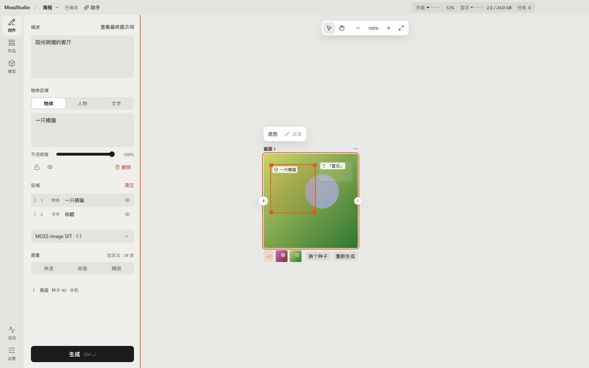

<p align="center">
  
</p>

<h1 align="center">MossStudio</h1>

<p align="center">
  给 <a href="https://github.com/OpenMOSS/MOSS-Image"><b>MOSS-Image</b></a> 用的节点式画板<br>
  写一句描述就出图 · 连线组合风格、起始图和放大 · 自带 <a href="https://github.com/mossimage-cpp/mossimage.cpp"><b>MossInfer</b></a> 推理引擎，不需要 Python
</p>

<p align="center">
  <a href="https://github.com/CloverIris/MossStudio/releases"></a>
  
  
  
  <br>
  
  
  
  
  
  
  
  
  <a href="https://github.com/mossimage-cpp/mossimage.cpp"></a>
</p>

---

<picture>
  <source media="(prefers-color-scheme: dark)" srcset="docs/assets/readme/studio-dark.png">
  
</picture>

## 这是什么

MossStudio 是 [MOSS-Image](https://github.com/OpenMOSS/MOSS-Image) 的桌面画板。画板上的每张「画面」是一张要生成的图：写一句描述，点「生成」，图片出现在卡片旁边。把「风格」「起始图」「参考图」这些节点连到画面上，就能让一组图保持同一种风格，或者改一张、放大一张。它面向第一次接触 AI 绘图的人：节点少、名字直白，用不了的功能会说明原因，而不是报一段堆栈。

- **下载即用**：引擎和模型都按显卡自动挑选并下载，不需要安装 Python、conda 或 PyTorch。
- **在本机生成**：推理由自带的 [MossInfer](https://github.com/mossimage-cpp/mossimage.cpp) 引擎在你的显卡上完成，图片不离开你的电脑；按显存自动安排哪些层常驻、哪些流式加载。
- **画板而不是表单**：画面、风格、起始图、遮罩、控制图、参考图都是卡片，连线决定谁影响谁；右键菜单里有「改一张图」「局部重绘」「放大一张图」等现成配方。
- **每次生成都留着**：画面下方的胶片条记录每一次运行，所有图片同时进入「作品」，可以随时「用作起始图」。
- **助手可选**：接入你自己的 OpenAI 兼容、Anthropic、Gemini 或 Ollama 账号后，助手能直接在画板上加卡片、改描述、发起生成，「自主」或「审批」两种模式。
- **更新很安静**：新版本在后台下载，下次打开就是新版，出问题会自动回到上一个版本。

## 支持的显卡

MossStudio 为每块显卡自动选一个引擎，规则来自代码（`apps/desktop/src/shared/engineChoice.ts`）。

| 显卡 | 引擎 | 能做什么 |
| --- | --- | --- |
| NVIDIA RTX 30 / 40 / 50 系列 | 「CUDA 13」或「CUDA 12」，按驱动版本自动选 | 全部功能：LoRA、起始图、遮罩、控制图、参考图、高清修复、实时预览 |
| Linux 上的 AMD RX 7900 系列、RX 9000 系列（gfx1100、gfx1200、gfx1201），装有 ROCm 7 | 「AMD 原生」（HIP） | 文生图 |
| 其他显卡（Windows 上的 AMD、Intel、驱动太旧的 NVIDIA） | 「兼容模式」（Vulkan） | 文生图，速度较慢 |
| macOS | 本机不能运行引擎 | 界面可用；生成交给一台装有 NVIDIA 显卡的 Linux 电脑（「远程主机」） |

显卡驱动、每个引擎支持的功能等细节以引擎仓库为准：[mossimage-cpp/mossimage.cpp](https://github.com/mossimage-cpp/mossimage.cpp)。

## 安装与第一张图

1. 到 [Releases](https://github.com/CloverIris/MossStudio/releases) 下载最新版本：Windows 是 `MossStudio-Setup-<版本>-x64.exe`，Linux 是 `MossStudio-Setup-<版本>-linux-x64.run`，macOS 是 `.dmg`。每个系统还有一个解压即用的便携版。
2. 运行安装包。安装程序会发现电脑上的旧版 MossStudio，默认沿用它的作品、模型和设置。
3. 第一次打开进入「准备开始创作」：确认显卡那一行，点「开始下载」。引擎和推荐模型一起下载，点「先去看看」可以边下边逛。
4. 下载完成后在「创作」里写一句描述，点「生成」。

每一步的截图、选项和出错时怎么办，见 [安装 MossStudio 并生成第一张图](docs/how-to/setup.md)。

## 性能

MossInfer 用 C++/CUDA 实现 MOSS-Image 的整条推理链路，不依赖 PyTorch。它在 RTX 5090 上的实测数据，包括和官方 diffusers 流水线的对比、各精度档的耗时与显存峰值，都在 [MossInfer 1.0.0 性能报告](docs/records/2026-10-31-mossinfer-1.0.0-performance.md) 里。

## 文档

| 文档 | 内容 |
| --- | --- |
| [文档索引](docs/README.md) | 全部文档的阅读地图 |
| [安装 MossStudio 并生成第一张图](docs/how-to/setup.md) | 面向用户：安装、首次运行、之后在哪里改设置 |
| [Studio 节点画板](docs/reference/studio-node-board.md) | 画面、风格、放大、输入、连线、区域、配方 |
| [引擎与显卡](docs/reference/engines.md) | 引擎包的选择与安装、档位、远程主机 |
| [模型](docs/reference/models.md) | 模型目录、部件、LoRA |
| [架构](docs/reference/architecture.md) | 进程、窗口、路由、服务与存储 |
| [设计决策](docs/decisions/README.md) | 每个重要选择的记录（ADR） |
| [MossInfer 引擎](https://github.com/mossimage-cpp/mossimage.cpp) | 引擎源码、协议与发布包 |

## 开发

```bash
pnpm install
pnpm dev
```

需要 Node 22 与 pnpm 9，Go 1.27 只在改启动器时需要。检查命令、CI 分层、分支与提交规范见 [CONTRIBUTING.md](CONTRIBUTING.md)；给编码助手的规则在 [AGENTS.md](AGENTS.md)。

## 许可

代码以 [MIT](LICENSE) 发布。推理引擎 [MossInfer](https://github.com/mossimage-cpp/mossimage.cpp) 以 Apache-2.0 独立开源；MOSS-Image 权重与训练器遵循各自上游许可，本仓库不分发这些模型。
